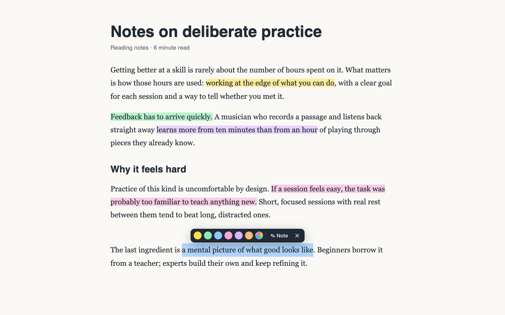
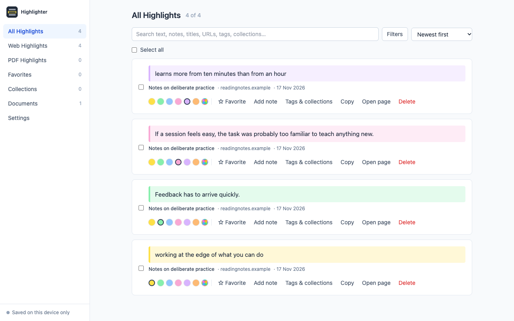

# Highlighter

Highlighter is a Chrome extension for highlighting text on webpages and PDFs, and finding those highlights again
later.

## What it does

- Select text on any webpage and pick a color: six presets or any custom color.
- Highlights reappear when you return to the page, even if the page has changed.
- A built-in PDF viewer lets you highlight PDFs too.
- A dashboard to search, filter, tag and organise your highlights, add notes, and export them as JSON or Markdown.
- Works without an account. Highlights are stored on your device.

## Google sign-in and your data

Signing in with Google is optional. It is used for one thing: syncing your highlights between your own devices.

If you turn sync on, Highlighter asks for permission to store its data in a hidden application folder in your own
Google Drive. It cannot see, change or delete any other file in your Drive. There is no server, and the developer
never receives your highlights or your account details.

Read the full [Privacy Policy](privacy).

## Links

- [Privacy Policy](privacy)
- [Source code on GitHub](https://github.com/aayushjoshi2709/highlighter)
- [Report a problem](https://github.com/aayushjoshi2709/highlighter/issues)
